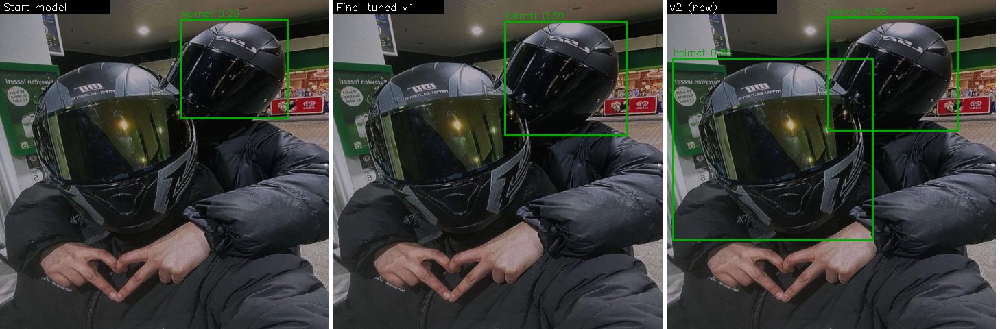
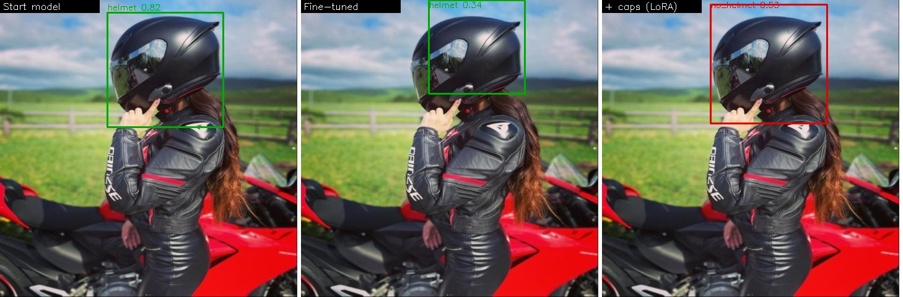
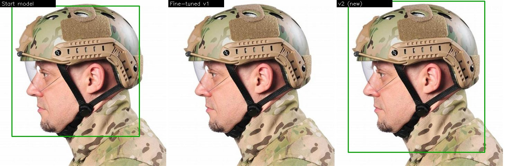

# Helmet / no-helmet detector for motorcycle riders

A small object detector (YOLO26m) that draws a box around a person's head and says whether they are wearing a **helmet** (green) or **no helmet** (red).

It started from the public model [`leeyunjai/yolo26-helmet`](https://huggingface.co/leeyunjai/yolo26-helmet) and was fine-tuned on riders from Indian and Southeast-Asian roads. This repo is the write-up: results, how it was trained, example outputs and the scripts. **The fine-tuned weights are on the [Releases page](https://github.com/GPA-N/helmet-detection-yolo26/releases/tag/v1.0)** (see [Weights](#weights) for the licence caveat).

## Example outputs

Each row shows the same photo through three models: the start model, our fine-tuned v1 and v1 + caps (LoRA). Green = helmet, red = no_helmet.

We took 13 evenly spaced images (every 50th) from the DeBoniz test split (licence CC-BY-4.0) and show 7 of them. We left out 2 where no model drew any box and 4 that were near-repeats (screenshots with overlay text) or tiny street scenes. Most of that split is close-ups and product photos, not street scenes, so it is a harsh test. It also shows the weak spots of the newest model, which sometimes calls a helmeted close-up "no_helmet" (rows 1, 3, 5 and 6).

## The models compared

| Name | What it is |
|---|---|
| Base YOLO26m (COCO) | The general-purpose pretrained YOLO26m. It knows 80 everyday object types and has **no helmet class**, so it cannot do this task and has no score here. |
| Start model | `helmet-26m` from `leeyunjai/yolo26-helmet`. The one we started from. |
| Fine-tuned v1 | Start model, all weights fine-tuned for 40 epochs on our rider data. |
| v1 + caps (full fine-tune) | v1, fine-tuned again with photos of people in caps, hats and headscarves labelled no_helmet. Changes every weight. |
| v1 + caps (LoRA) | Same extra photos, but only small add-on layers are trained, so the original weights stay put. Also mixes in the old model's own predictions so it does not forget. **Experimental, not recommended as the default:** it over-calls no_helmet on helmeted close-ups (see the examples). A fixed version is being trained. |

## Benchmarks

All numbers are on our own splits (below). **Precision (P)** = of the boxes drawn, how many were right. **Recall (R)** = of the real heads, how many were found. **AP50 / AP50-95** = how good the boxes and their confidence are (higher is better, 1.0 is perfect). **mAP** = the average over the two classes. P and R are at the confidence level that gives the best balance (Ultralytics' standard report).

### Overall (mAP50 / mAP50-95)

| Split | Start model (`helmet-26m`) | Fine-tuned v1 | v1 + caps (full fine-tune) | v1 + caps (LoRA) |
|---|---|---|---|---|
| Test (48 images) | 0.867 / 0.588 | 0.965 / 0.692 | 0.973 / 0.695 | 0.956 / 0.690 |
| Dev (147 images) | 0.252 / 0.072 | 0.771 / 0.318 | 0.756 / 0.308 | 0.790 / 0.324 |
| Train (868 images) | 0.253 / 0.087 | 0.977 / 0.624 | 0.977 / 0.623 | 0.970 / 0.616 |

### Test set, per class

| Model | Class | P | R | AP50 | AP50-95 |
|---|---|---|---|---|---|
| Start model (`helmet-26m`) | helmet | 0.942 | 0.640 | 0.846 | 0.553 |
|  | no_helmet | 0.727 | 0.880 | 0.889 | 0.624 |
| Fine-tuned v1 | helmet | 0.949 | 0.960 | 0.979 | 0.741 |
|  | no_helmet | 0.952 | 0.900 | 0.951 | 0.643 |
| v1 + caps (full fine-tune) | helmet | 0.986 | 0.920 | 0.980 | 0.749 |
|  | no_helmet | 0.956 | 0.878 | 0.966 | 0.642 |
| v1 + caps (LoRA) | helmet | 1.000 | 0.872 | 0.982 | 0.736 |
|  | no_helmet | 0.897 | 0.880 | 0.929 | 0.644 |

### Dev set, per class

| Model | Class | P | R | AP50 | AP50-95 |
|---|---|---|---|---|---|
| Start model (`helmet-26m`) | helmet | 0.528 | 0.222 | 0.232 | 0.078 |
|  | no_helmet | 0.180 | 0.477 | 0.271 | 0.067 |
| Fine-tuned v1 | helmet | 0.834 | 0.800 | 0.870 | 0.392 |
|  | no_helmet | 0.743 | 0.570 | 0.673 | 0.243 |
| v1 + caps (full fine-tune) | helmet | 0.838 | 0.808 | 0.862 | 0.386 |
|  | no_helmet | 0.743 | 0.586 | 0.649 | 0.229 |
| v1 + caps (LoRA) | helmet | 0.826 | 0.802 | 0.872 | 0.393 |
|  | no_helmet | 0.716 | 0.625 | 0.707 | 0.254 |

### People in caps and hats, and forgetting

120 held-out photos from the DeBoniz dataset where the person wears a cap, hat or headscarf (correct answer: no_helmet). The last column is how much of v1's old behaviour is kept: the share of v1's confident detections on 200 unlabelled street photos that the model still reproduces (1.0 = nothing forgotten).

| Model | Called no_helmet (correct) | Called helmet (wrong) | Old behaviour kept |
|---|---|---|---|
| Start model (`helmet-26m`) | 71% | 28% | 0.63 |
| Fine-tuned v1 | 38% | 38% | 1.000 |
| v1 + caps (full fine-tune) | 95% | 4% | 0.935 |
| v1 + caps (LoRA) | 93% | 4% | 0.944 |

(Start-model "old behaviour kept" is measured the same way against v1.)

### Read these numbers carefully

- **The test set is tiny**: 48 images, 25 helmet and 50 no_helmet boxes. Differences of about 0.01 (for example 0.965 vs 0.973) are noise. Treat the test numbers as a rough guide only. They were also looked at several times while making choices.
- **The dev set has incomplete labels.** On v1, only 10 of 466 labelled heads got the wrong class. 78 had no detection at all (mostly tiny or blurry heads), and 79 detections sat where there is no label at all. Of 32 of those we looked at, most were real heads or helmets that the labels simply do not mark. So dev scores of 0.6 to 0.8 are partly the labels' fault, not only the model's.
- **Train vs dev gap.** v1 scores 0.977 on training images, 0.771 on dev and 0.965 on test. Some of that train-to-dev gap is overfitting to the training photos and some is the label problem above. We have not separated the two.
- **The cap photos come from the same source** as the extra training photos, so the 93-95% is optimistic for photos from elsewhere.
- **The start model scores low on train and dev** (0.25) partly because it draws its boxes differently from our labels, and then well on the test set (0.867), whose labelling style it matches better.
- **Trade-off, not a free win.** The caps versions fix most cap/hat mistakes, but the LoRA one loses some helmet recall (test helmet recall 0.960 to 0.872) and over-calls no_helmet on helmeted close-ups. The full fine-tune forgets more of v1's behaviour (0.935 kept vs 0.944).

## How it was trained

Everything ran on a free Google Colab T4 GPU.

1. **Data.** Two public rider datasets, converted to head-level boxes with two classes (`helmet`, `no_helmet`); number-plate and whole-rider boxes were dropped. 868 training images (2,121 helmet and 899 no_helmet boxes), 147 dev images, 48 test images and 400 unlabelled street photos used only to check forgetting. Images were grouped into clusters of near-identical pictures and split by cluster, so no near-duplicate sits on both sides of a split.
2. **Fine-tuned v1.** Start model, **all weights** trained for 40 epochs with Ultralytics' default settings (640 px images, batch 16, automatic AdamW).
3. **Finding caps and hats.** None of our data labels caps, hats or headscarves as such, so we used OpenAI's CLIP (zero-shot: "a person wearing a baseball cap", and so on) to pick them out of the no_helmet boxes of the DeBoniz dataset. Picks were checked by eye on photo grids (mostly correct, some bare faces slip in). Those images all keep the label no_helmet.
4. **Caps, full fine-tune.** v1 trained 15 more epochs on our images plus 400 cap images. Changes every weight.
5. **Caps, LoRA.** The original weights and normalisation layers are frozen. Small rank-8 add-on layers (4.3% extra parameters) are put on 122 convolution layers and trained for 15 epochs on our images, 900 cap images and 200 "replay" photos labelled by v1 itself (so the model keeps doing what it used to). The add-ons are then folded back into an ordinary model with no change to its shape.

## What did not work

Before fine-tuning again, we tried to fix the cap mistake by **editing a handful of weights directly without any training** ("weight-space programming"). Four different kinds of edit, each checked against random edits of the same size, were no better than chance or cost accuracy elsewhere. The model's features for a cap and a helmet are too similar for a few-weight edit to separate them, so we fine-tuned instead.

## Data and credits

| Source | Used for | Licence (as listed by the host) |
|---|---|---|
| [aneesarom/rider-with-helmet-without-helmet-number-plate](https://www.kaggle.com/datasets/aneesarom/rider-with-helmet-without-helmet-number-plate) (Kaggle) | train, test | Apache-2.0 |
| [aryanvaid13/indian-helmet-detection-dataset](https://www.kaggle.com/datasets/aryanvaid13/indian-helmet-detection-dataset) (Kaggle) | train, dev | "unknown" on Kaggle |
| devgurucodes/trafffic-violations-triple-riding-no-helmet-plate, pkdarabi/helmet (Kaggle) | unlabelled street photos for the forgetting check only | see each page |
| [DeBoniz/helmet-detection-dataset](https://huggingface.co/datasets/DeBoniz/helmet-detection-dataset) (Hugging Face) | cap/hat photos for training; held-out cap test; example images | CC-BY-4.0 |
| [leeyunjai/yolo26-helmet](https://huggingface.co/leeyunjai/yolo26-helmet) | start model | none stated |
| [openai/clip-vit-base-patch32](https://huggingface.co/openai/clip-vit-base-patch32) | finding caps and hats | MIT |

Built with [Ultralytics YOLO](https://github.com/ultralytics/ultralytics) (AGPL-3.0). Check each dataset's terms before reusing its images.

## Weights

Download from the [v1.0 release](https://github.com/GPA-N/helmet-detection-yolo26/releases/tag/v1.0). Each file is a normal Ultralytics model (`YOLO('file.pt')`); class 0 = helmet, class 1 = no_helmet.

| File | Model |
|---|---|
| `helmet-v1-finetune.pt` | Fine-tuned v1 |
| `helmet-v1-caps-full.pt` | v1 + caps (full fine-tune) |
| `helmet-v1-caps-lora.pt` | v1 + caps (LoRA). **Experimental: misses helmets on close-ups. Prefer the other two for now.** |

**Licence caveat:** these were fine-tuned from `leeyunjai/yolo26-helmet`, which states no licence, and Ultralytics code is AGPL-3.0. The weights are shared as-is, with no warranty, and may be taken down if the start model's author objects. The start model itself is not included: get it from its Hugging Face page.

## Not included
- **Datasets and the source images behind the numbers.** Download them from the links above.
- **Photos from web searches** that were used for informal spot checks. We do not own them.

## Scripts and raw results

| File | What it does |
|---|---|
| [`benchmarks.json`](benchmarks.json) | Every number in the tables above |
| [`scripts/build_dataset.py`](scripts/build_dataset.py) | Builds the train/dev/test/unlabelled splits |
| [`scripts/lora_exp.py`](scripts/lora_exp.py) | CLIP cap mining, LoRA training, merging and evaluation |
| [`scripts/bench_gh.py`](scripts/bench_gh.py) | The benchmark behind the tables |
| [`scripts/render_gh.py`](scripts/render_gh.py) | Draws the example images |
| [`scripts/kit.py`](scripts/kit.py), [`scripts/setup_all.py`](scripts/setup_all.py) | Helpers and Colab setup |

The scripts were written for Colab (paths start with `/content`). They are provided as a record, not a polished package.

## Licence

The code in this repo is MIT-licensed (see `LICENSE`). Datasets and models keep their own licences.
