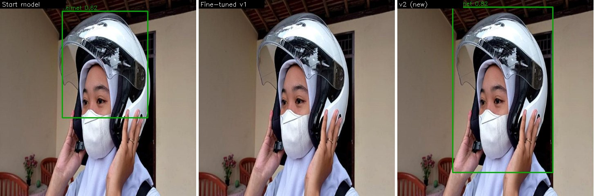
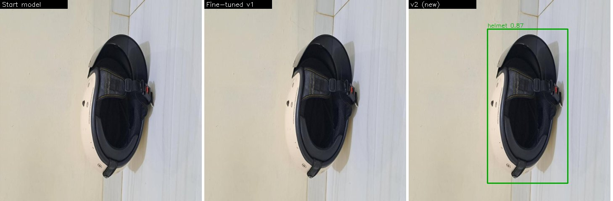
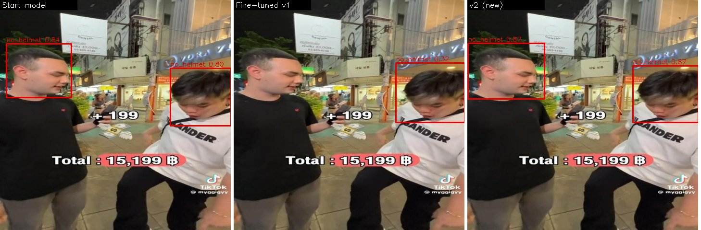
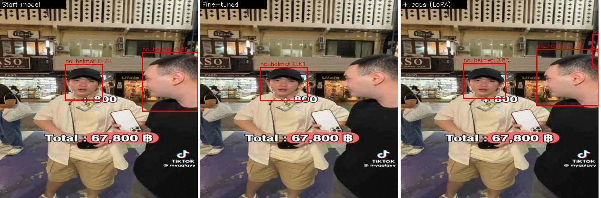
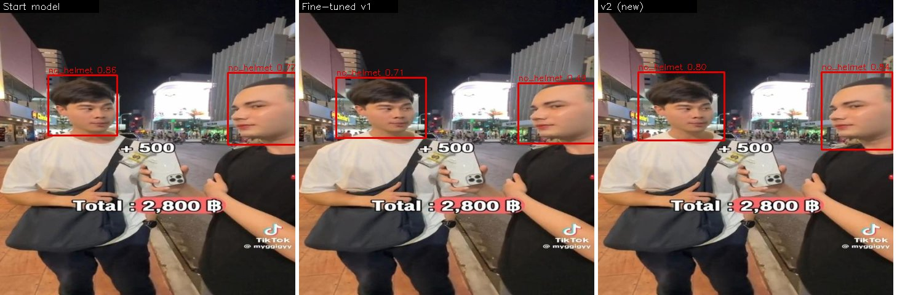
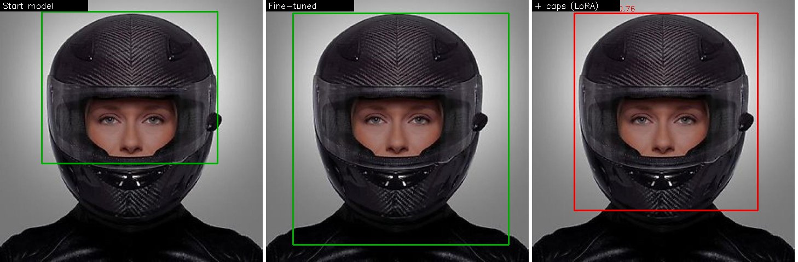
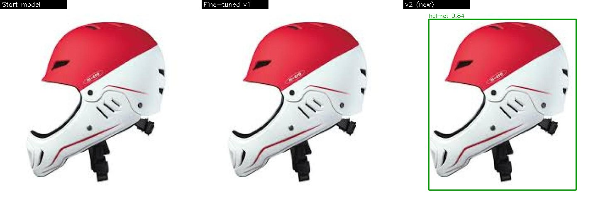
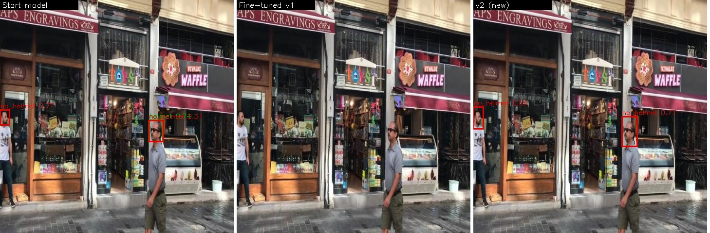
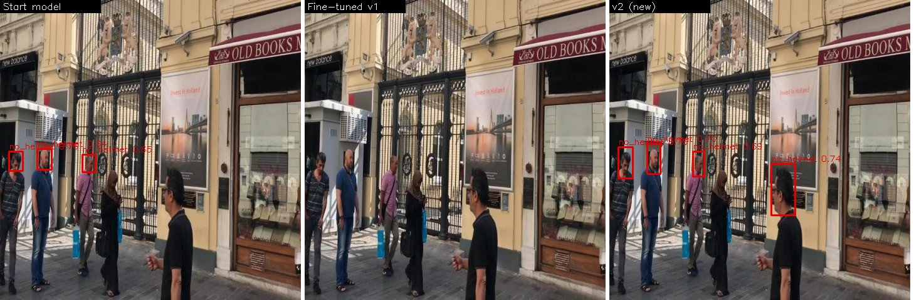
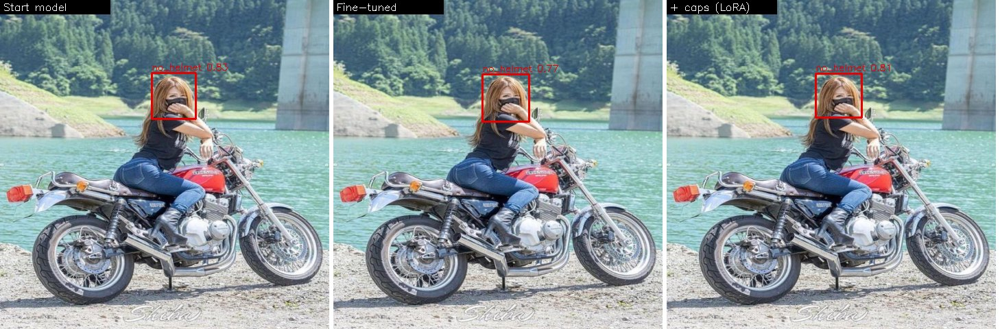

# Helmet / no-helmet detector for motorcycle riders

A small object detector (YOLO26m) that draws a box around a person's head and says whether they are wearing a **helmet** (green) or **no helmet** (red).

**Latest: v2.** It starts from the public model [`leeyunjai/yolo26-helmet`](https://huggingface.co/leeyunjai/yolo26-helmet) and is fine-tuned with the **plain Ultralytics trainer at its default settings**, no custom training code. Weights are on the [v2.0 release](https://github.com/GPA-N/helmet-detection-yolo26/releases/tag/v2.0); [how to run it](#use-it-inference) is below.

## Results at a glance

mAP50 (higher is better, 1.0 is perfect):

| Test set | Start model | Fine-tuned v1 | **v2 (new)** |
|---|---|---|---|
| DeBoniz test (643 images) | 0.616 | 0.554 | **0.970** |
| Our test (48 images) | 0.867 | **0.965** | 0.947 |
| Our dev (147 images) | 0.252 | **0.771** | 0.701 |

v2 is far better on the large DeBoniz test set. It is slightly behind v1 on our two small sets, which use our own labelling style. See [what these numbers do and do not show](#read-these-numbers-carefully).

## Use it (inference)

Install Ultralytics and download `helmet-v2.pt` from the [v2.0 release](https://github.com/GPA-N/helmet-detection-yolo26/releases/tag/v2.0):

```bash
pip install ultralytics
curl -L -o helmet-v2.pt https://github.com/GPA-N/helmet-detection-yolo26/releases/download/v2.0/helmet-v2.pt
```

Python:

```python
from ultralytics import YOLO

model = YOLO("helmet-v2.pt")
results = model.predict("photo.jpg", conf=0.25)   # also accepts a folder, a video file or a webcam index

for r in results:
    for box in r.boxes:
        label = r.names[int(box.cls)]              # "helmet" or "no_helmet"
        print(label, float(box.conf), box.xyxy[0].tolist())   # confidence and [x1, y1, x2, y2] in pixels
    r.save("photo_out.jpg")                        # photo with the boxes drawn
```

Or from the command line (annotated output goes to `runs/detect/predict`):

```bash
yolo predict model=helmet-v2.pt source=photo.jpg conf=0.25
```

Things to know:
- **Output:** one box per head, class 0 = `helmet` (green in our pictures), class 1 = `no_helmet` (red). It finds heads, not whole riders, and it does not check whether the person is on a motorcycle.
- **Confidence (`conf`):** 0.25 is the Ultralytics default and what every number and picture in this README uses (the confusion matrices are at 0.25). Raise it (for example 0.5) for fewer false alarms and more misses, lower it for the opposite.
- **Image size:** 640 px by default. Very small or far-away heads are often missed.
- **Speed:** during validation on a Colab T4 GPU (batch of 16, 640 px) the model took about 10.6 ms per image for the network step (inference only), plus about 2 ms of post-processing. We did not time CPU, other GPUs or video pipelines.
- **Not a safety or enforcement tool.** It makes mistakes (see the failures above), so treat its output as a hint to be checked, not a verdict about a person.

## Example outputs

Each row is the same photo through the start model, v1 and v2 (confidence 0.25). Green = helmet, red = no_helmet. These are **all 13 images** from taking every 50th image of the DeBoniz test split (licence CC-BY-4.0), nothing skipped. Many are close-ups and product photos, not street scenes.






















## The models

| Name | What it is |
|---|---|
| Start model | `helmet-26m` from `leeyunjai/yolo26-helmet`. Where everything starts. |
| Fine-tuned v1 | Start model, all weights trained 40 epochs on our own 868 rider images. |
| **v2 (new)** | Start model, all weights trained with default Ultralytics settings on the 16,384-image DeBoniz training set plus our 868 images, for a 30-minute budget (3 epochs). |

Earlier experiments ("v1 + caps", full and LoRA) are no longer recommended: on held-out DeBoniz photos of helmets worn on heads they called the helmet correctly less often than the start model (see below). Their files stay on the [v1.0 release](https://github.com/GPA-N/helmet-detection-yolo26/releases/tag/v1.0).

## Benchmarks

**P** = of the boxes drawn, how many were right. **R** = of the real heads, how many were found. **AP50** = box quality and confidence ranking at IoU 0.5. P and R are at the confidence with the best balance (Ultralytics' standard report). mAP50 / mAP50-95:

| Split | Start model | Fine-tuned v1 | v2 (new) |
|---|---|---|---|
| DeBoniz test (643 images) | 0.616 / 0.319 | 0.554 / 0.297 | **0.970 / 0.706** |
| Our test (48 images) | 0.867 / 0.588 | **0.965 / 0.692** | 0.947 / 0.542 |
| Our dev (147 images) | 0.252 / 0.072 | **0.771 / 0.318** | 0.701 / 0.289 |

### DeBoniz test, per class

| Model | Class | P | R | AP50 |
|---|---|---|---|---|
| Start model | helmet | 0.726 | 0.414 | 0.479 |
|  | no_helmet | 0.640 | 0.773 | 0.752 |
| Fine-tuned v1 | helmet | 0.561 | 0.509 | 0.542 |
|  | no_helmet | 0.925 | 0.425 | 0.567 |
| **v2 (new)** | helmet | 0.941 | 0.940 | 0.981 |
|  | no_helmet | 0.948 | 0.936 | 0.959 |

### Our test, per class

| Model | Class | P | R | AP50 |
|---|---|---|---|---|
| Start model | helmet | 0.942 | 0.640 | 0.846 |
|  | no_helmet | 0.727 | 0.880 | 0.889 |
| Fine-tuned v1 | helmet | 0.949 | 0.960 | 0.979 |
|  | no_helmet | 0.952 | 0.900 | 0.951 |
| **v2 (new)** | helmet | 0.960 | 0.880 | 0.937 |
|  | no_helmet | 0.887 | 0.946 | 0.957 |

### Our dev, per class

| Model | Class | P | R | AP50 |
|---|---|---|---|---|
| Start model | helmet | 0.528 | 0.222 | 0.232 |
|  | no_helmet | 0.180 | 0.477 | 0.271 |
| Fine-tuned v1 | helmet | 0.834 | 0.800 | 0.870 |
|  | no_helmet | 0.743 | 0.570 | 0.673 |
| **v2 (new)** | helmet | 0.755 | 0.763 | 0.796 |
|  | no_helmet | 0.596 | 0.641 | 0.606 |

### Confusion matrices (confidence 0.25)

Counts of boxes at confidence 0.25 (Ultralytics' standard confusion matrix, IoU 0.45). Rows are what the model said, columns are the truth. The **Nothing column** = boxes drawn where no head is labelled (false alarms; many are real heads the labels miss, see below). The **Nothing row** = labelled heads that got no box (misses). Overall precision / recall are pooled over both classes at this fixed confidence, unlike the per-class tables above, which use Ultralytics' best-balance confidence.

**DeBoniz test (643 images)**

| Model | Said \ Truth | helmet | no_helmet | Nothing | Precision | Recall |
|---|---|---|---|---|---|---|
| Start model | helmet | 220 | 18 | 83 | 0.618 | 0.603 |
|  | no_helmet | 42 | 456 | 275 |  |  |
|  | Nothing (missed) | 268 | 117 | - |  |  |
| Fine-tuned v1 | helmet | 256 | 41 | 140 | 0.704 | 0.431 |
|  | no_helmet | 2 | 227 | 20 |  |  |
|  | Nothing (missed) | 272 | 323 | - |  |  |
| **v2 (new)** | helmet | 504 | 6 | 44 | 0.923 | 0.946 |
|  | no_helmet | 2 | 557 | 36 |  |  |
|  | Nothing (missed) | 24 | 28 | - |  |  |

**Our test (48 images)**

| Model | Said \ Truth | helmet | no_helmet | Nothing | Precision | Recall |
|---|---|---|---|---|---|---|
| Start model | helmet | 21 | 0 | 20 | 0.432 | 0.933 |
|  | no_helmet | 2 | 49 | 70 |  |  |
|  | Nothing (missed) | 2 | 1 | - |  |  |
| Fine-tuned v1 | helmet | 24 | 1 | 5 | 0.753 | 0.933 |
|  | no_helmet | 1 | 46 | 16 |  |  |
|  | Nothing (missed) | 0 | 3 | - |  |  |
| **v2 (new)** | helmet | 22 | 1 | 2 | 0.772 | 0.947 |
|  | no_helmet | 2 | 49 | 16 |  |  |
|  | Nothing (missed) | 1 | 0 | - |  |  |

**Our dev (147 images)**

| Model | Said \ Truth | helmet | no_helmet | Nothing | Precision | Recall |
|---|---|---|---|---|---|---|
| Start model | helmet | 74 | 6 | 98 | 0.238 | 0.290 |
|  | no_helmet | 61 | 61 | 267 |  |  |
|  | Nothing (missed) | 203 | 61 | - |  |  |
| Fine-tuned v1 | helmet | 280 | 6 | 75 | 0.749 | 0.764 |
|  | no_helmet | 4 | 76 | 34 |  |  |
|  | Nothing (missed) | 54 | 46 | - |  |  |
| **v2 (new)** | helmet | 257 | 10 | 73 | 0.712 | 0.725 |
|  | no_helmet | 2 | 81 | 52 |  |  |
|  | Nothing (missed) | 79 | 37 | - |  |  |

Pictures of the DeBoniz test matrices (each cell as a share of the true class): [start](images/cm_start_deb_test.png), [v1](images/cm_v1_deb_test.png), [v2](images/cm_v2_deb_test.png).

### TP, FP, FN and F1 (confidence 0.25)

From the matrices above. For a class: **TP** = boxes of that class that match a real head of that class; **FP** = boxes of that class that do not (wrong class or no real head there); **FN** = real heads of that class with no matching box of that class (missed or labelled as the other class). **F1** = 2 x P x R / (P + R). There is no TN count: in detection there is no fixed set of "correctly empty" regions to count.

| Set | Model | Class | TP | FP | FN | Precision | Recall | F1 |
|---|---|---|---|---|---|---|---|---|
| DeBoniz test | Start model | helmet | 220 | 101 | 310 | 0.685 | 0.415 | 0.517 |
|  |  | no_helmet | 456 | 317 | 135 | 0.590 | 0.772 | 0.669 |
|  |  | both (pooled) | 676 | 418 | 445 | 0.618 | 0.603 | 0.610 |
|  | Fine-tuned v1 | helmet | 256 | 181 | 274 | 0.586 | 0.483 | 0.529 |
|  |  | no_helmet | 227 | 22 | 364 | 0.912 | 0.384 | 0.540 |
|  |  | both (pooled) | 483 | 203 | 638 | 0.704 | 0.431 | 0.535 |
|  | **v2 (new)** | helmet | 504 | 50 | 26 | 0.910 | 0.951 | 0.930 |
|  |  | no_helmet | 557 | 38 | 34 | 0.936 | 0.942 | 0.939 |
|  |  | both (pooled) | 1061 | 88 | 60 | 0.923 | 0.946 | 0.935 |
| Our test | Start model | helmet | 21 | 20 | 4 | 0.512 | 0.840 | 0.636 |
|  |  | no_helmet | 49 | 72 | 1 | 0.405 | 0.980 | 0.573 |
|  |  | both (pooled) | 70 | 92 | 5 | 0.432 | 0.933 | 0.591 |
|  | Fine-tuned v1 | helmet | 24 | 6 | 1 | 0.800 | 0.960 | 0.873 |
|  |  | no_helmet | 46 | 17 | 4 | 0.730 | 0.920 | 0.814 |
|  |  | both (pooled) | 70 | 23 | 5 | 0.753 | 0.933 | 0.833 |
|  | **v2 (new)** | helmet | 22 | 3 | 3 | 0.880 | 0.880 | 0.880 |
|  |  | no_helmet | 49 | 18 | 1 | 0.731 | 0.980 | 0.838 |
|  |  | both (pooled) | 71 | 21 | 4 | 0.772 | 0.947 | 0.850 |
| Our dev | Start model | helmet | 74 | 104 | 264 | 0.416 | 0.219 | 0.287 |
|  |  | no_helmet | 61 | 328 | 67 | 0.157 | 0.477 | 0.236 |
|  |  | both (pooled) | 135 | 432 | 331 | 0.238 | 0.290 | 0.261 |
|  | Fine-tuned v1 | helmet | 280 | 81 | 58 | 0.776 | 0.828 | 0.801 |
|  |  | no_helmet | 76 | 38 | 52 | 0.667 | 0.594 | 0.628 |
|  |  | both (pooled) | 356 | 119 | 110 | 0.749 | 0.764 | 0.757 |
|  | **v2 (new)** | helmet | 257 | 83 | 81 | 0.756 | 0.760 | 0.758 |
|  |  | no_helmet | 81 | 54 | 47 | 0.600 | 0.633 | 0.616 |
|  |  | both (pooled) | 338 | 137 | 128 | 0.712 | 0.725 | 0.718 |

### Helmets worn on heads (DeBoniz val+test)

584 held-out images with only helmet boxes, where CLIP says the helmet is on a person's head (682 boxes). Share of those boxes each model labels correctly as helmet at confidence 0.25. v2 was not measured on this set.

| Model | Called helmet (correct) | Called no_helmet (wrong) | Missed |
|---|---|---|---|
| Start model | 65% | 11% | 24% |
| Fine-tuned v1 | 60% | 1% | 39% |
| v1 + caps (full fine-tune) | 41% | 36% | 23% |
| v1 + caps (LoRA) | 35% | 38% | 27% |

### Read these numbers carefully

- **The DeBoniz test set is held-out images, but v2 trained on the same dataset's training split.** Pictures from one source tend to resemble each other, and we did not check for near-duplicates between its train and test splits. Expect lower scores on photos from elsewhere. The start model and v1 never trained on it, so the comparison favours v2.
- **v2 is slightly behind v1 on our own splits** (test mAP50 0.947 vs 0.965, dev 0.701 vs 0.771), and its boxes match our labelling less tightly (test mAP50-95 0.542 vs 0.692). v1 was trained on that labelling style, v2 mostly was not.
- **"Nothing" false alarms are not all mistakes.** In our dev set many boxes the models draw sit on real heads the labels do not mark (we looked at 32 of 79 for v1), so dev precision is understated.
- **Our test set is tiny** (48 images). Differences of about 0.02 are noise. Our dev set has incomplete labels, so its absolute numbers are low for every model.
- **Known failures on real street photos.** On one informal street photo, v2 missed a rider in a headscarf with headphones and called a bareheaded rider "helmet" at low confidence (0.32). Headscarf and cap cases need more training data. v2 only trained for 3 epochs.
- **No photos from web searches are shown here**; we do not own them.

## How it was trained

Everything ran on a free Google Colab T4 GPU.

1. **v1.** Start model, all weights, 40 epochs on our 868 rider images (Ultralytics defaults: 640 px, batch 16, automatic optimizer).
2. **v2.** `YOLO('helmet-26m.pt').train(data=..., time=0.5)`, nothing else changed. Training data = DeBoniz train (16,384 images, 2 classes: helmet / no_helmet) + our 868 train images. `time=0.5` is Ultralytics' own time budget in hours; it ran 3 epochs. Validation during training used the DeBoniz val split. The final `last.pt` is the released model.

The recipe is [`scripts/train_v2.py`](scripts/train_v2.py) and the evaluation is [`scripts/eval_v2.py`](scripts/eval_v2.py).

## What did not work

- **Editing a few weights without training** ("weight-space programming") to fix cap/hat mistakes: four kinds of edit, each no better than random edits of the same size.
- **Our own LoRA and replay fine-tunes** ("v1 + caps"): they fixed some cap photos but made helmets worse on held-out DeBoniz images (table above), and over-called no_helmet on helmeted close-ups. We stopped using them.
- **Blending a share of the start model back in** (weight interpolation, as suggested in [arXiv 2609.36426](https://arxiv.org/abs/2609.36426)) helped those models a little but did not bring them back to the start model.

## Data and credits

| Source | Used for | Licence (as listed by the host) |
|---|---|---|
| [DeBoniz/helmet-detection-dataset](https://huggingface.co/datasets/DeBoniz/helmet-detection-dataset) (Hugging Face) | v2 training, DeBoniz test, example images | CC-BY-4.0 |
| [aneesarom/rider-with-helmet-without-helmet-number-plate](https://www.kaggle.com/datasets/aneesarom/rider-with-helmet-without-helmet-number-plate) (Kaggle) | our train, test | Apache-2.0 |
| [aryanvaid13/indian-helmet-detection-dataset](https://www.kaggle.com/datasets/aryanvaid13/indian-helmet-detection-dataset) (Kaggle) | our train, dev | "unknown" on Kaggle |
| [leeyunjai/yolo26-helmet](https://huggingface.co/leeyunjai/yolo26-helmet) | start model | none stated |
| [openai/clip-vit-base-patch32](https://huggingface.co/openai/clip-vit-base-patch32) | finding head-worn helmets in the analysis above | MIT |

Built with [Ultralytics YOLO](https://github.com/ultralytics/ultralytics) (AGPL-3.0). Check each dataset's terms before reusing its images.

## Weights

[v2.0 release](https://github.com/GPA-N/helmet-detection-yolo26/releases/tag/v2.0): `helmet-v2.pt`, a normal Ultralytics model (`YOLO('helmet-v2.pt')`); class 0 = helmet, class 1 = no_helmet. Older models are on [v1.0](https://github.com/GPA-N/helmet-detection-yolo26/releases/tag/v1.0).

**Licence caveat:** fine-tuned from `leeyunjai/yolo26-helmet` (no licence stated) with AGPL-3.0 Ultralytics code. Weights are shared as-is, with no warranty, and may be taken down if the start model's author objects. The start model itself is not included.

## Not included
- Datasets and the source images behind the numbers. Download them from the links above.

## Scripts and raw results

| File | What it does |
|---|---|
| [`benchmarks_v2.json`](benchmarks_v2.json) | Every v2 number above |
| [`benchmarks.json`](benchmarks.json) | Older benchmark of v1 and the "caps" models |
| [`scripts/train_v2.py`](scripts/train_v2.py), [`scripts/eval_v2.py`](scripts/eval_v2.py) | v2 training and evaluation |
| [`scripts/build_dataset.py`](scripts/build_dataset.py), [`scripts/kit.py`](scripts/kit.py), [`scripts/setup_all.py`](scripts/setup_all.py) | Our train/dev/test splits and Colab setup |
| [`scripts/lora_exp.py`](scripts/lora_exp.py), [`scripts/bench_gh.py`](scripts/bench_gh.py), [`scripts/render_gh.py`](scripts/render_gh.py) | Earlier LoRA/caps experiments and the old examples |

Scripts were written for Colab (paths start with `/content`). They are a record, not a polished package.

## Licence

The code in this repo is MIT-licensed (see `LICENSE`). Datasets and models keep their own licences.
